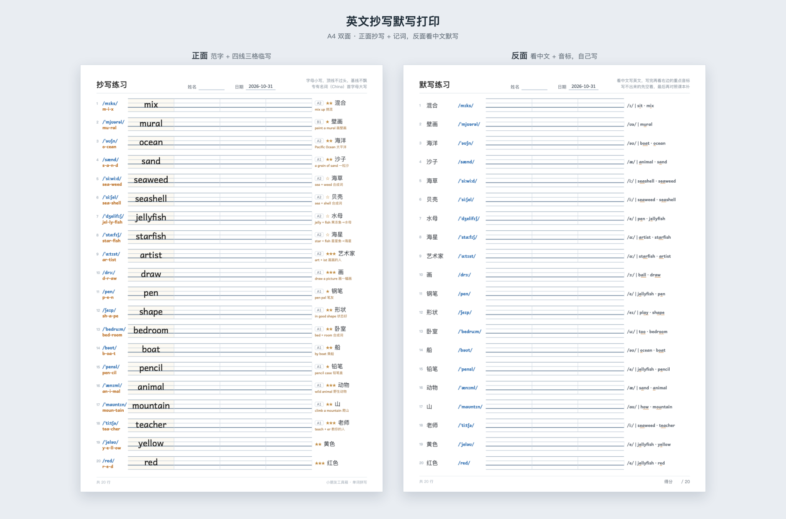
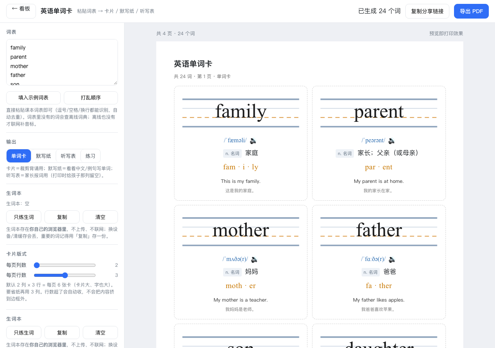

# 小朋友工具箱

> 给家长和小朋友的免费小工具 · 纯网页、免登录、不收集任何数据

**🌐 在线使用：<https://kid-toolbox.github.io/>**

| 工具 | 在线使用 | 做什么 |
|---|---|---|
| ✍️ 田字格字帖打印 | [/tianzige/](https://kid-toolbox.github.io/tianzige/) | 粘贴生字，生成带笔顺、描红的 A4 练习页 |
| 📝 英文抄写默写打印 | [/sheet/](https://kid-toolbox.github.io/sheet/) | 输入单词，生成正面抄写、反面默写的双面 A4 纸 |
| 🔤 英语单词卡 | [/words/](https://kid-toolbox.github.io/words/) | 粘贴词表，生成单词卡 / 默写纸 / 听写表 |
| 🎮 背单词闯关 | [/words/learn/](https://kid-toolbox.github.io/words/learn/) | 听词选意 → 拼单词 → 排音节 → 看意写 |


## ✍️ 田字格字帖打印（`tianzige/`）

粘贴课本生字 → 自动生成 A4 练习页：**范字 + 笔顺条 + 空白格**。可调格子大小 / 每页字数 / 每行几格 / 描红格数 / 田字格·米字格 / A4·A5·横向，带拼音、组词、成语、占格提示，点「导出 PDF」即可打印。


## 📝 英文抄写默写打印（`sheet/`）

输入这周要学的单词，一键生成 **A4 双面练习纸**：**正面抄写 + 记词，反面默写**。

每行一个词 —— 左边音标和拼读切分，中间范字带三格临写，右边中文、难度和记忆点。
反面只给中文和音标，让孩子自己写出来。



**特色**

- **英式音标** —— 和国内教材一致（`yellow /ˈjeləʊ/`），不是美式
- **自然拼读切分** —— `l-igh-t`、`sea-shell`，让孩子看见"哪几个字母发哪个音"
- **记忆点** —— 合成词拆解（`sea + shell`）、常用搭配（`a grain of sand` 一粒沙）、
  不发音字母；只在真有钩子时才给，不硬凑
- **英语书写字体** —— 字母 `a`、`g` 是单层写法，和小学课本的手写体一致，不是印刷体的双层 a
- **难度和词频标注** —— 一眼看出这个词值不值得现在花时间

**两个标记怎么看**

| 标记 | 含义 |
|---|---|
| `A1` | 入门词 · 小学低年级高频，日常马上能用 |
| `A2` | 基础词 · 小学中高年级常见 |
| `B1` | 进阶词 · 明显超出日常，多在阅读里遇到 |
| `★★★` | 英语最常见的 1000 词，必须秒认秒写 |
| `★★` | 前 3000 词，日常够用 |
| `★` | 前 10000 词，值得学 |
| `☆` | 前 10000 名以外（含专有名词），认识就行，不必死练拼写 |

> 分级看难度，星级看值不值得现在花时间。**A1 + ★★★** = 必掌握；**B1 + ☆** = 知道就好。

## 🔤 英语单词卡（`words/`）

粘贴课本词表，生成 **单词卡 / 默写纸 / 听写表**。每张卡带英式音标、拆音节、中文和例句，
点 🔊 就能朗读；支持复制分享链接，换台设备打开还是同一份词表。



## 🎮 背单词闯关（`words/learn/`）

听词选意思 → 拼单词 → 排音节 → 看意思写，**一关一个词**。答对有星星和撒花，答错不扣分；
答错的词自动记进「生词本」，可以一键做成默写纸打印。


<details>
<summary>看田字格工具界面</summary>


</details>

## 本地用

双击 `index.html` 就行——数据用 `<script>` 加载，`file://` 直接打开也能完整运行，不依赖网络。

## 更新线上

```bash
git add -A && git commit -m "改了什么" && git push     # 约 1 分钟后自动生效
```

## 数据来源与授权

| 内容 | 来源 | 授权 |
|---|---|---|
| 汉字笔画 / 中心线 | [Make Me a Hanzi](https://github.com/skishore/makemeahanzi) → [hanzi-writer-data](https://github.com/chanind/hanzi-writer-data) | Arphic Public License（见 `ARPHICPL.TXT`） |
| 拼音 | [pinyin-data](https://github.com/mozillazg/pinyin-data) | MIT |
| 英汉释义 / 音标 / 词性 | [ECDICT](https://github.com/skywind3000/ECDICT) 筛出常用 5000 词 | MIT |
| 英文四线三格 | 本项目自绘（SVG），总高 9mm，对齐小学英语练习本 | 随本项目 |
| 词组 / 成语 / 占格提示 | 本项目整理（一年级上册第一课 16 字） | 随本项目 |

代码为 MIT（见 `LICENSE`）。再次分发请保留 `ARPHICPL.TXT` 和 `NOTICE`。
